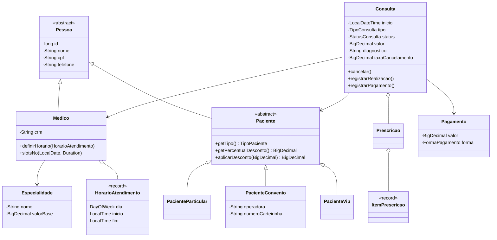

# Clínica Bem Estar — Sistema de Gestão

Trabalho de Programação Orientada a Objetos (POO) em Java. O sistema automatiza o
agendamento de consultas, o cadastro de médicos, especialidades e pacientes, o cálculo
do valor das consultas (de acordo com a especialidade e o tipo de paciente), o
histórico clínico com prescrições eletrônicas, o registro de pagamentos e o relatório
de faturamento por tipo de paciente. Os dados são salvos em arquivos CSV.

## Como executar

### Dependências e versões

| Ferramenta | Versão | Observação |
|---|---|---|
| JDK | 17 ou superior | testado com OpenJDK 21 |
| Maven | 3.8 ou superior | testado com Maven 3.9 |
| JUnit | 5.10 | baixado automaticamente pelo Maven; usado só nos testes |

O sistema não usa nenhuma biblioteca externa em tempo de execução, nem credenciais ou
chaves de API (por isso não há `.env.example`).

### Passo a passo

1. Clone o repositório e entre na pasta:

   ```bash
   git clone https://github.com/rodriguesarrais/trabalho-poo.git
   ```

   ```bash
   cd trabalho-poo
   ```

2. Compile, rode os testes e gere o `.jar`:

   ```bash
   mvn package
   ```

3. Execute:

   ```bash
   java -jar target/clinica.jar
   ```

Os dados ficam na pasta `dados/` do diretório atual. Para usar outra pasta, informe-a
como argumento:

```bash
java -jar target/clinica.jar /caminho/para/minha-pasta
```

Na primeira execução (pasta vazia), o sistema oferece carregar **dados de exemplo**
(4 especialidades, 5 médicos com horários, 4 pacientes e algumas consultas futuras),
o que facilita a demonstração.

Para rodar apenas os testes automatizados:

```bash
mvn test
```

Sem Maven, também é possível compilar e executar só com o JDK:

```bash
mkdir -p out && javac -d out $(find src/main/java -name "*.java") && java -cp out br.com.bemestar.clinica.Main
```

## Requisitos atendidos

| Requisito | Onde está implementado |
|---|---|
| Cadastro de especialidades com valor base e associação de médicos | `CadastroService`, `Especialidade`, `Medico` |
| Cadastro de horários de atendimento dos médicos | `HorarioAtendimento`, `Medico#definirHorario` |
| Agendamento por médico ou por especialidade, em horários livres de 30 min, sem dois agendamentos no mesmo horário para o mesmo médico | `AgendaService#agendar`, `#agendarPorEspecialidade`, `#horariosDisponiveis` |
| Encaixes emergenciais: máximo de 2 por médico por dia, com acréscimo de 20% | `AgendaService#agendarEncaixe`, `PoliticaPrecos` |
| Cancelamento com menos de 24h de antecedência cobra taxa de 50% | `AgendaService#cancelar`, `PoliticaPrecos#calcularTaxaCancelamento` |
| Pacientes Particular (valor cheio), Convênio (20% de desconto) e VIP (30% de desconto) | `PacienteParticular`, `PacienteConvenio`, `PacienteVip` |
| Cálculo automático do valor por especialidade e tipo de paciente | `PoliticaPrecos#calcularValorConsulta` |
| Histórico de consultas e diagnósticos | `AgendaService#registrarRealizacao`, `ProntuarioService#historicoDoPaciente` |
| Prescrições eletrônicas vinculadas a consultas já realizadas | `ProntuarioService#emitirPrescricao`, `Prescricao`, `ItemPrescricao` |
| Registro de pagamento de cada consulta | `FaturamentoService#registrarPagamento`, `Pagamento` |
| Relatório de faturamento por tipo de paciente | `FaturamentoService#gerarRelatorio`, `RelatorioFaturamento` |

### Requisitos não funcionais do trabalho

| Diretriz | Como foi atendida |
|---|---|
| Persistência por arquivos (CSV/JSON/TXT) | `ArmazenamentoCsv`: um arquivo CSV por entidade, gravado automaticamente após cada operação |
| Não quebrar em entradas inválidas | `Entrada` repete a pergunta até receber número, data, hora ou valor válido; erros de regra de negócio são exibidos e o menu continua |
| Não quebrar com arquivos ausentes | Pasta ou arquivos ausentes são tratados como base vazia |
| Arquivos corrompidos | Mensagem com arquivo, linha e coluna do problema; o usuário pode mover os arquivos para uma pasta `backup-<data>` e iniciar vazio, ou sair sem alterar nada |
| Falha ao gravar | A gravação usa arquivo temporário e troca atômica (sem arquivos pela metade); uma falha é avisada sem encerrar o sistema |
| Interface | Console com menus numerados |
| README com instruções | Este arquivo |

### Funcionalidades adicionais

- **Edição e remoção** de especialidades, médicos e pacientes. A remoção é bloqueada quando
  apagaria o histórico: um médico ou paciente com consultas, ou uma especialidade com
  médicos associados.
- **Exportação** do relatório de faturamento para arquivo TXT (`dados/relatorios/`), com
  filtro opcional por período.
- **Agendamento por especialidade**, que escolhe automaticamente um médico livre.
- **Consulta de horários livres** por médico ou por especialidade, e de encaixes restantes no dia.
- **Pagamentos pendentes**: lista consultas realizadas, ou canceladas com taxa, ainda não pagas.
- **Validação de CPF** (11 dígitos, com ou sem pontuação) e de CPF ou CRM duplicados.
- **Dados de exemplo** para demonstração.
- **Testes automatizados** (JUnit 5) das regras de negócio e da persistência.

## Regras de negócio e decisões de projeto

- **Duração e grade:** toda consulta dura 30 minutos. Os horários de uma consulta normal
  são os slots de 30 min contados a partir do início do turno do médico naquele dia da semana.
- **Conflitos:** um médico não pode ter duas consultas normais no mesmo slot, e um paciente
  não pode ter duas consultas agendadas que se sobreponham. Não é possível agendar no passado.
- **Encaixes:** por definição, um encaixe pode ocupar um horário já agendado, mas precisa
  estar dentro do turno do médico e não pode coincidir com outro encaixe. Encaixes
  cancelados liberam a vaga.
- **Valor:** é calculado e fixado no momento do agendamento:
  `valor base da especialidade × (1 − desconto do paciente) × (1,20 se for encaixe)`.
  Exemplo para Cardiologia (R$ 300,00): Particular R$ 300,00, Convênio R$ 240,00,
  VIP R$ 210,00; como encaixe: R$ 360,00, R$ 288,00 e R$ 252,00.
- **Cancelamento:** permitido apenas para consultas agendadas que ainda não começaram. Se a
  antecedência for menor que 24h, é cobrada taxa de 50% do valor da consulta; com 24h ou
  mais, não há taxa. Consultas canceladas liberam o horário.
- **Pagamento:** registrado para consultas realizadas (valor integral) ou canceladas com
  taxa (valor da taxa). Cada consulta pode ser paga uma única vez.
- **Faturamento:** soma dos pagamentos, agrupada por tipo de paciente, para todo o período
  ou para um intervalo de datas.
- **Valores monetários** usam `BigDecimal` com duas casas decimais, evitando erros de
  arredondamento de `double`.
- **Persistência:** ao carregar os arquivos, as entidades são reconstruídas pelos próprios
  métodos do domínio (`Consulta.cancelar`, `registrarRealizacao`, `registrarPagamento` etc.).
  Assim, dados inconsistentes no disco são rejeitados pelas mesmas regras usadas na interface.

## Conceitos de POO aplicados

- **Encapsulamento:** as entidades protegem o seu estado. Por exemplo, `Consulta` só muda de
  status pelos métodos `cancelar`, `registrarRealizacao` e `registrarPagamento`, que
  validam as transições permitidas.
- **Herança:** `Pessoa` → `Medico` e `Paciente`; `Paciente` → `PacienteParticular`,
  `PacienteConvenio` e `PacienteVip`.
- **Abstração e polimorfismo:** `Paciente` é abstrata e cada subclasse define
  `getTipo()` e `getPercentualDesconto()`; o cálculo de preço não precisa saber qual é o
  tipo concreto do paciente.
- **Interfaces e generics:** `Repositorio<T extends Identificavel>`, com a implementação
  `RepositorioEmMemoria<T>`; os serviços dependem da interface, não da implementação.
  Da mesma forma, a interface de console depende de `Armazenamento`, e não de
  `ArmazenamentoCsv`: trocar CSV por JSON ou banco de dados não exige mudar o restante.
- **Composição e associação:** `Medico` tem uma `Especialidade` e uma agenda de
  `HorarioAtendimento`; `Consulta` agrega `Prescricao` e `Pagamento`.
- **Enums com comportamento**, `record`s imutáveis (`HorarioAtendimento`, `ItemPrescricao`,
  `RelatorioFaturamento`) e **exceções** próprias (`RegraNegocioException`,
  `EntidadeNaoEncontradaException`).
- **Injeção de dependência** do relógio (`java.time.Clock`), o que permite testar as regras
  de 24h e de "não agendar no passado" com datas fixas.

## Estrutura do projeto

```
src/main/java/br/com/bemestar/clinica
├── Main.java                 ponto de entrada
├── Clinica.java              monta repositórios e serviços
├── modelo/                   entidades e regras do domínio
├── repositorio/              Repositorio<T>, RepositorioEmMemoria<T> e BaseDeDados
├── persistencia/             Armazenamento, ArmazenamentoCsv e leitura/escrita de CSV
├── servico/                  CadastroService, AgendaService, ProntuarioService,
│                             FaturamentoService, PoliticaPrecos, HistoricoPaciente
├── relatorio/                RelatorioFaturamento e ExportadorRelatorio (TXT)
├── excecao/                  exceções do domínio
└── console/                  interface de texto (menus), leitura de dados, dados de exemplo
src/test/java/...             testes JUnit 5 das regras de negócio e da persistência
```

### Arquivos de dados

| Arquivo | Conteúdo |
|---|---|
| `especialidades.csv` | id, nome, valor base |
| `medicos.csv` | id, nome, CPF, telefone, CRM, id da especialidade |
| `horarios.csv` | id do médico, dia da semana, início, fim |
| `pacientes.csv` | id, tipo (PARTICULAR/CONVENIO/VIP), nome, CPF, telefone, operadora, carteirinha |
| `consultas.csv` | id, paciente, médico, início, tipo, valor, status, diagnóstico, observações, dados do cancelamento |
| `prescricoes.csv` e `itens_prescricao.csv` | prescrições e seus medicamentos |
| `pagamentos.csv` | id, consulta, valor, forma, data |

Os arquivos usam `;` como separador e UTF-8, e podem ser abertos no Excel ou no LibreOffice.

## Diagrama de classes (simplificado)


